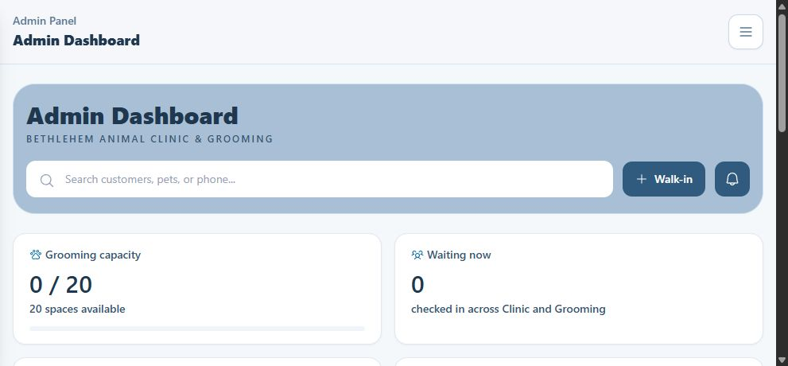

# Local Admin navigation performance verification — 19 October 2026

All implementation remains on `gerald-frontend`, without commits, pushes, deployment, Hostinger access or production changes. No database migration was needed. Browser checks used the existing application at `http://127.0.0.1:8000` and existing local customers/pets/cases. Add/Edit Pet forms were cancelled without saving. A notification already marked read was marked read again to exercise a real mutation without changing its effective state.

## Measured browser flow

DevTools Network/CDP recorded a cache-bypassing Dashboard reload, then normal sidebar navigation through Customers → Grooming → Clinic → Dashboard → Customers → Grooming → Clinic. The automated Ctrl+F5 chord did not cause navigation, so DevTools `Page.reload({ignoreCache:true})` supplied the equivalent browser cache bypass. Only the explicit presentation cache was cleared for a genuine initial data miss; authentication/identity were preserved.

| Visit | Before API requests | Final API requests |
| --- | ---: | ---: |
| Cold Dashboard | 6 | 5 |
| Customers | 4 | 3 |
| Grooming | 4 | 4 |
| Clinic | 5 | 3 |
| Repeat Dashboard | 5 | 1 |
| Repeat Customers | 4 | 1 |
| Repeat Grooming | 5 | 3 |
| Repeat Clinic | 4 | 1 |
| **Total** | **37** | **21** |

These are observed request counts, not a controlled wall-clock benchmark. The investigation had longer dwell times than the rapid final verification. Freshness policies deliberately produce additional requests when their short lifetimes expire; an earlier rapid verification produced 19 requests. The final run above includes a necessary notifications revalidation on first Grooming and a status revalidation on repeat Grooming. The eight `/session` checks remain necessary and unchanged.

In the final cold run the API order was session → summary → activity → notifications → Clinic status. Summary renders independently of secondary results, and the sidebar's cold Dashboard status read waits for primary readiness. Shared status callers still produce one network request.

All four repeat pages had their primary content loaded and no visible loader at the verification snapshots. Clinic's first Patient Records request started after active cases completed, through the viewport observer. Its own cold secondary loader remains valid while that directory loads. Confined was absent from ordinary startup and fetched once when its tab was opened.

Normal navigation recorded **127 static browser-cache hits** in the final flow. No HTTP cache headers were changed. No `/me`, full Grooming board request on Dashboard, identical concurrent API duplicates, application exceptions, failed requests or HTTP errors appeared in the final flow.

Sanitized endpoint/request metadata is in [the Network evidence JSON](admin-navigation-2026-10-19-network.json). It excludes bearer tokens, request headers and response bodies. Obsolete development-only request entries were subsequently removed from the evidence; the aggregate counts above remain the original historical measurements, not current request counts.

## Causes and implementation

- The previous Admin cache discarded entries at the fresh TTL, leaving nothing to render during a subsequent network read. It now separates freshness from retention and renders retained data before revalidation.
- Customers' `_customerCache` disappeared on HTML navigation and overlapped the API cache. It and its page-local invalidation bookkeeping were removed; the shared API cache owns list/filter/search reuse.
- Six pet editor dependencies and the form markup loaded during directory startup. They now load only for pet editing. Opening a customer profile uses a lightweight shared weight formatter, extracted into the existing presentation-format service, without importing pet form controls.
- Forced sidebar Grooming activity reads bypassed recent results. The force flag and its unnecessary prerequisite were removed. Dashboard/Grooming keep their existing authoritative badge event bridge.
- Normal Grooming entry and its 30-second visible polling no longer force fresh requests. Successful relevant mutations invalidate its group, so subsequent reads are authoritative. Explicit force remains supported for a true forced refresh.
- Clinic operational cases use the same retained-render helper, with visibility-aware 30-second refreshes. Its former eager Patient Records load now uses an IntersectionObserver with a 200px margin after primary cases load. Only the first records page is cached; pagination remains on demand.
- Successful mutations invalidate resource groups, rather than clearing all Admin presentation data. In-flight reads carry session/epoch/group revision guards; a superseded response cannot refill the cache or replace a newer mutation result.
- Retained data is re-read after server session verification. It cannot bypass session checking or locking. Temporary 5xx/network refresh failures preserve valid retained presentation; 401/403 errors still reject through the normal handlers.

## Cache policies

All persistence remains in one versioned, session-owned API cache (`bethlehem.admin.presentation.v2`). Its owner includes API origin, role and the non-secret Sanctum token ID; the full token is compared only in memory. Authentication/session cleanup removes both old and current cache versions. Cross-tab signals carry affected groups. Entry count is bounded to 24 with LRU reuse.

| Resource | Fresh | Retained | Persistence |
| --- | ---: | ---: | --- |
| Dashboard summary/activity | 15 s | 120 s | Session presentation |
| Grooming board | 5 s | 60 s | Session presentation |
| Grooming sidebar activity | 15 s | 60 s | Session presentation |
| Clinic active cases | 5 s | 60 s | Lightweight session list only |
| Customers list/status/tier filters | 30 s | 180 s | Bounded session list |
| Free-text customer searches | 5 s | 15 s | Memory only, bounded |
| Patient Records page 1 | 30 s | 180 s | Directory presentation only |
| Notifications | 10 s | 60 s | Session presentation |
| Clinic status | 15 s | 30 s | Session presentation |
| Confined cases | 0 | 0 | In-flight sharing only; always fetch on demand |

Every eligible Admin GET shares identical in-flight requests. Mutations are never deduplicated. Full case workspaces, records, vitals, attachments, credentials and security details are not added to this cache. Grooming's existing operational card/safety information is preserved; its payload was not split or reduced because those consumers need it.

## Mutation groups

| Mutation | Invalidated groups |
| --- | --- |
| Grooming internal/visit notes or sedation consent | grooming |
| Other Grooming workflow/payment/release/pickup actions | grooming, dashboard |
| Grooming check-in/revert/cancellation | Also customers, since booking tier/count can change |
| Grooming completion/cancellation | Also notifications |
| Grooming walk-in creation | grooming, dashboard, notifications, customers, clinic-records |
| Customer creation/account status/archive | customers, clinic-records, clinic-active; keeps unrelated Grooming data |
| Pet/profile edits | customers, clinic-records, clinic-active, clinic-confined, grooming, dashboard; patient names/weights/safety presentation can change |
| Pet vaccination endpoints | clinic-active |
| Clinic case/appointment operations | clinic-active, dashboard |
| Clinic check-in/cancel/finish/payment | Also notifications |
| Clinic confinement actions | Also clinic-confined |
| Clinic walk-in/case creation | Also customers, clinic-records; walk-in also notifications |
| Notification read/read-all | notifications only |
| Clinic stop/reopen | clinic-status only |
| Relevant availability/groomer/catalogue settings | grooming, dashboard |

Successful online status GETs that reconcile a paid result also invalidate the associated operational groups. Clinic payment validation conflicts explicitly bypass the fresh list cache before retrying authoritative amounts. Unrelated security/settings writes no longer erase all presentation resources.

## Backend measurements

The local profiler reads existing local MySQL data inside a rolled-back transaction, including any expiry writes caused by existing controller behavior. Counts include controller/schema checks and exclude HTTP authentication middleware. Timings are single samples and are not a production throughput claim.

| Endpoint | Queries before → after | JSON bytes before → after | Controller ms before → final |
| --- | ---: | ---: | ---: |
| Customers | 37 → 3 | 4,724 → 4,724 | 41.68 → 30.72 |
| Dashboard summary | 17 → 17 | 204 → 204 | 37.19 → 41.36 |
| Dashboard activity | 19 → 19 | 1,043 → 1,043 | 16.78 → 25.24 |
| Grooming board | 18 → 18 | 2,381 → 2,381 | 22.64 → 24.94 |
| Grooming activity | 1 → 1 | 22 → 22 | 0.51 → 0.61 |
| Clinic active cases | 33 → 14 | 2,784 → 713 | 34.54 → 20.78 |
| Clinic records | 4 → 4 | 5,893 → 5,893 | 5.98 → 7.25 |

Customer booking counts use correlated aggregate subqueries in the customer SELECT. Cancelled bookings remain excluded from bookingCount; returning/new still excludes cancelled, waiting_to_arrive, expired and no_show. Tier-filtered pet searches now use an EXISTS predicate instead of an owner-by-owner query. The SQLite regression measured **11 → 31 queries** when growing from 3 to 13 customers before the change, and **5 → 5** after, including its request/middleware setup.

Clinic active/expected/payment lists no longer eager-load vitals, medical records, attachments, charges or confinement workspace details. Their required owner/pet, status, queue, timing, complaint and total fields remain. Full details are fetched by an authorized, uncached `GET /admin/clinic-cases/{id}` when opening a workspace/payment review. Full-detail relations remain available there and for existing detail/mutation consumers. Relation discovery is reused within each controller request instead of repeated for every row. A populated SQLite fixture measured **577 bytes for a list row versus 2,036 bytes for the full case**, while asserting medical/billing detail queries are absent from the list.

## Verification and limits

- Focused PHP suite: **243 passed, 2,656 assertions**, using forced in-memory SQLite. Covers Customers, Dashboard, Clinic cases/services/confinement and authorization.
- Full frontend regression runner: **69/72 scripts passed**. Two failures also reproduce with source from the original `HEAD`: `clinic-case-workspace-regression.cjs` expects an obsolete Billing icon string; `frontend-pos-regression.cjs` expects an obsolete barcode SVG URL. They were not weakened or fixed as unrelated work.
- Added behavioral regressions cover ownership/logout/session replacement, fresh/retained reads, deduplication, mutation races, 5xx/network retention, authorization propagation, precise and cross-tab invalidation, bounded searches, Customers startup/search races, weight display without the editor, Dashboard priority, Manila Grooming dates, viewport-deferred records and on-demand Confined behavior.
- Browser: a throttled repeat Customers visit displayed all 17 existing customers while its refresh remained pending, with zero full loaders. Dashboard and Clinic retained their primary data under delayed refreshes. A simulated local Clinic 503 preserved visible content. The real already-read notification PATCH invalidated notifications while keeping Customers, Dashboard and Clinic cached.
- Browser: Add Pet and Edit Pet controls worked with existing records, without saving. A full existing Clinic workspace loaded its saved vitals and Billing total only after Open Case. Confined requested its dataset on tab entry. The final four-page flow had no application console/network errors.
- Authentication, inactivity and Clinic role regressions passed.

No new sample customer, pet, booking or Clinic case was inserted into the running local database. Destructive/operational transitions such as completing a real patient or collecting payment were exercised by isolated regression fixtures rather than changing existing local clinical work.

Remaining costs are deliberate: each document still verifies the protected session; cold reads and short-lived operational revalidation remain real requests. PHP's local single-process server magnifies serial request timings. Dashboard summary/activity and the Grooming payload were preserved after profiling rather than rewritten without a demonstrated new query-growth problem. No Core Web Vitals field-performance claim is made from this local request-count test.

Shared-script URL versions were updated on other Admin HTML consumers so they use the same cache/invalidation protocol; those pages received no UI or workflow changes.

